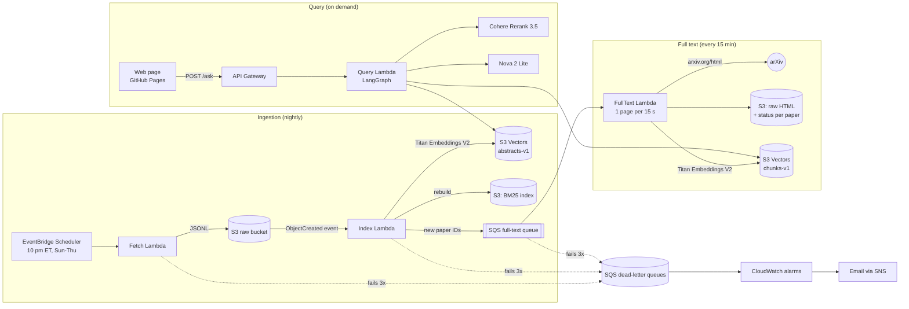
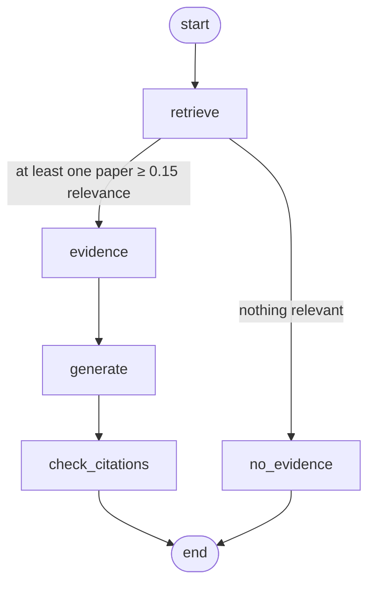

# arXiv Research Assistant

**A serverless RAG system that reads new AI papers from arXiv every night, full text included, and answers questions about them with citations.**

**[Try it live](https://vaibhavarshney.github.io/arxiv-research-assistant/)**

Ask something like *"What's new in RAG evaluation?"* or *"What retention did Gemini-3.1-Pro get on StateTrack-Bench?"* and get a short answer where every claim links to the paper it came from, with the sections of the paper that backed it. If the index doesn't contain enough evidence, it says so instead of guessing.

    

> **Status:** Phase 2 complete (full text, reranking, hybrid search, retrieval and answer evals). See the [roadmap](#roadmap) for what's next.

---

## Highlights

- **Runs itself.** A nightly schedule pulls new papers from cs.CL, cs.AI and cs.IR. Abstracts are indexed as soon as the file lands in S3, and full text follows through a rate-limited queue within the hour.
- **Reads the whole paper.** arXiv's HTML versions are parsed into sections and chunked along section boundaries, so answers can quote numbers from result tables, not just the abstract.
- **Two-stage ranking.** Vector search casts a wide net of 50 papers, then a cross-encoder reranker (Cohere Rerank 3.5) picks the ones that actually answer the question.
- **Measured, not guessed.** A labelled eval set of 45 questions drove every change. One feature (hybrid search) was built, measured, and deliberately left switched off because it didn't earn its latency.
- **Says "I don't know."** A calibrated relevance threshold stops weak matches from reaching the LLM. If nothing passes, the model is never called.
- **Grounded answers.** The model may only use retrieved abstracts and passages, must cite paper IDs, and every citation is checked in code.
- **Cheap to run.** Full text for ~4,000 papers cost **under $1** to embed. A normal night costs a few cents.
- **Fails loudly.** Failed runs retry, then land in dead-letter queues that trigger an email alarm.

---

## Architecture



### The query pipeline



| Node | What it does |
|---|---|
| `retrieve` | Embeds the question, pulls the 50 nearest abstracts, reranks them with Cohere, and keeps up to 5 scoring at least 0.15 |
| `evidence` | Searches the full-text chunks of **only those papers**, reranks the passages, and keeps the best 8 (at most 3 per paper) |
| `generate` | Sends each abstract plus its passages, labelled by section, to the LLM with strict grounding and citation rules |
| `check_citations` | Flags any cited paper ID that wasn't among the retrieved papers |
| `no_evidence` | Returns an honest "couldn't find enough" message without calling the LLM |

Every stage degrades instead of failing. If the reranker is down, retrieval falls back to cosine similarity. If the chunk index is unavailable, answers use abstracts only.

---

## Phase 2: what changed and what it measured

Phase 1 had one main weakness. For broad questions, every retrieved paper scored within a few hundredths of the others (0.42 to 0.47), so the right paper didn't stand out. Phase 2 set out to fix that, and to let answers use the whole paper.

### The eval set came first

Before changing anything, I built a labelled retrieval eval so every step could be measured.

- **45 questions:** 20 *specific* (one paper, paraphrased so no title words leak in), 10 *broad* (many acceptable papers), 10 *keyword* (using the paper's own term, like "StateTrack-Bench") and 5 *off-topic* (sourdough, bike chains), which should score low.
- **Fair labels.** Broad questions were labelled by pooling candidates from **both** vector search and BM25 and judging every abstract. Pooling from one retriever only would have quietly favoured it: re-pooling found 25 relevant papers that vector search's top 25 had missed.
- **A frozen corpus.** The live index grows every night, and unjudged new papers were pushing labelled ones down overnight. The eval now scores against a fixed snapshot of the 3,398 papers it was labelled on.
- **Metrics:** hit@1, recall@5, MRR, and an off-topic check that calibrates the "is this relevant enough?" threshold.

### Reranking: the fix for bunched scores

| | Vector only | + Cohere rerank | + BM25 hybrid + rerank |
|---|---|---|---|
| **Specific** hit@1 / MRR | 0.80 / 0.87 | **0.95 / 0.96** | 0.95 / 0.95 |
| **Broad** recall@5 / MRR | 0.37 / 0.73 | **0.51 / 0.78** | 0.51 / 0.83 |
| **Keyword** hit@1 / MRR | 0.90 / 0.91 | **1.00 / 1.00** | 1.00 / 1.00 |
| Median latency (laptop) | 197 ms | 603 ms | 900 ms |

*40 answerable questions, same index state for all three runs.*

A vector embedding squeezes each abstract into a single point *before* it sees the question. A cross-encoder reads the question and the abstract *together*, so it can tell "about this topic" apart from "answers this question." The scores also spread out. The same broad question that used to return 0.42 to 0.47 now returns 0.85 down to 0.71, so the best paper visibly stands out.

That spread made a better threshold possible. Off-topic questions top out at **0.053** in rerank score, while the best relevant paper for a real question never drops below **0.253**. The threshold sits at **0.15**, well inside the gap. One query shows the difference: asked how to replace a bike chain, vector search returned *Chain-of-Thought* papers because of the shared word, and the reranker scored them 0.01 to 0.02.

### Hybrid search: built, measured, left off

BM25 keyword search (my own inverted index in S3, rebuilt nightly, fused with vectors using Reciprocal Rank Fusion) surfaced genuinely relevant papers that vector search missed. But after reranking, the final top 5 was the same on **39 of 40 questions**, for about 300 ms more per query.

I set the decision rule *before* seeing the result: ship hybrid only if it wins on keyword questions, BM25's home turf. It tied (both 1.00), so it ships behind a flag (`USE_HYBRID`), switched off. The index still rebuilds nightly in about 6 seconds, so turning it on is one config change. At 4,000 papers the reranker's 50-paper candidate window already holds what matters. As the corpus grows, that window gets crowded, and BM25 is worth re-testing.

### Full text: two-level retrieval

| Detail questions (8, from table values and method results) | Abstracts only | + Full-text passages |
|---|---|---|
| Correct answers | **1 / 8** | **6 / 8** |
| Avg input tokens | 758 | 1,427 |
| Median latency (laptop) | 1.35 s | 1.75 s |

Every full-text answer quoted the exact value from the paper, such as "Gemini-3.1-Pro: 62.4%", "Cohen's κ 0.87" and "prepending recovers 62% of lost compliance". With abstracts only, the model mostly said, correctly, that the detail wasn't given. The one abstracts-only pass is a value that really is in the abstract.

The two full-text misses happened at the **paper** level. Their details (which model was the judge, how many outputs were scored) aren't in the abstract, so the paper never reached the top 5, and passage search only looks inside the top 5. That's the known cost of two-level retrieval, and the next thing to fix.

*Scope:* the 8 questions come from one paper and were written to target details outside its abstract. They show the capability, not overall answer accuracy. Expanding this set is on the roadmap.

### The full-text pipeline in numbers

| Metric | Result |
|---|---|
| Papers with full text | 3,968 processed; about **93% have an HTML version** in the runs sampled (the rest stay abstract-only) |
| Chunks per paper | ~44 (median chunk ~1,070 characters) |
| Embedding tokens per paper | ~13,600 |
| Backfill of 3,717 papers | ~18 hours unattended, **under $1**, 0 errors in every run checked, **0 rate limits** |
| Throughput | ~47 papers per 15-minute run, one arXiv request every 15 s |
| Nightly new papers | queued automatically, done within about 1.5 hours |

---

## Measured performance

All numbers below come from real runs of this system, not estimates.

| Metric | Result |
|---|---|
| Papers per day (cs.CL + cs.AI + cs.IR) | ~285 |
| Abstract embedding cost | ~$0.006 per 1,000 papers |
| Full-text embedding cost | ~$0.27 per 1,000 papers |
| Re-indexing 236 papers already in the index | 0 embedded, 0.6 s, $0 (incremental skip) |
| BM25 index rebuild, 3,717 papers | 5.5 s, 124 MB memory, 1.0 MB gzipped |
| Query latency, Phase 1 (warm Lambda) | ~1.3 s (retrieve ~290 ms, generate ~1.0 s) |
| Query latency, Phase 2 (laptop, end to end) | ~3.6 to 4.9 s (search, paper rerank, chunk search, passage rerank, generate) |
| Tokens per query, Phase 2 | ~1,400 to 3,600 in / ~100 out |
| Query latency, cold start | ~6.2 s (1.1 s container init + ~3.5 s importing LangGraph) |
| Failure to alert email | ~2 min after the final retry |

**Laptop vs Lambda:** in Phase 1, retrieval dropped from ~1,300 ms on a laptop to ~290 ms in a warm Lambda, because the function sits inside AWS's network next to Bedrock and S3 Vectors. Phase 2's laptop numbers are an upper bound for the same reason.

---

## Key design decisions

### Retrieval

**Two-stage ranking: a wide net, then a precise judge.** Vector search is fast but coarse. A cross-encoder is precise but too slow for the whole index. Pulling 50 candidates by vector and reranking them gets most of the cross-encoder's precision at a fraction of the cost. Cohere Rerank 3.5 was the only Bedrock reranker available in `us-east-1`.

**Two-level retrieval instead of searching every chunk.** Ranking papers by abstract already works (hit@1 0.95 on specific questions). Searching ~160,000 chunks directly would bring back the bunched-score problem, because many papers share near-identical paragraphs like "we evaluate on...". So abstracts pick the papers, and a filtered search (`arxiv_id in [top 5]`) finds the best passages inside them. The LLM gets each paper's own summary plus the specifics.

**A threshold calibrated from data.** The relevance cut-off comes from the eval's off-topic questions, not from intuition, and the eval script reports it on every run.

**Hybrid search ships off by default.** It tied on the eval. Keeping it behind a flag, with its index maintained, means the decision is cheap to revisit as the corpus grows.

### Full text

**HTML, not PDF.** arXiv converts LaTeX to HTML (LaTeXML), which keeps sections, paragraphs, captions and formulas as tags. PDFs lose all of that: two columns, hyphenated words, and headers mixed into the text.

**Section-aware chunks with contextual headers.** Chunks are built from whole paragraphs (~350 to 400 tokens), never cross a section boundary, and carry a header like `Paper title > 5 Results > 5.2 Ablations` into the embedding. Tiny subsections merge with their neighbours. Tables are flattened into readable rows so their numbers are searchable. References, acknowledgments, checklists and prompt templates are dropped, and appendices are capped at 15 chunks per paper.

**A queue and a polite worker, not a long loop.** arXiv's robots.txt asks for 15 s between requests, which makes the backfill ~16 hours and a normal night ~70 minutes, far beyond Lambda's 15-minute limit. An SQS queue holds the backlog, and a scheduled worker takes ~50 papers per run and stops. Papers that fail 3 times go to a dead-letter queue instead of blocking the rest. A `429` from arXiv ends the run immediately.

**Never ask arXiv twice.** Raw HTML is kept in S3 (gzipped), so improving the chunker means re-chunking from S3, not re-crawling. A status file per paper makes every step idempotent: duplicate messages, retries and repeat backfills never fetch or index anything twice.

### Infrastructure (Phase 1, still true)

**S3 Vectors instead of a vector database cluster.** Storage is billed like S3, and nothing runs when nobody is searching. The tradeoff is fewer search features, such as no built-in keyword search, which is why BM25 is a small index of its own.

**Idempotent, incremental indexing.** Vectors are keyed by arXiv ID (chunks by `id#nnn`), so re-running any step overwrites instead of duplicating, and only new papers or newer versions are embedded.

**Single-purpose functions with least-privilege roles.** Fetch, index, full text and query each get their own timeout, memory and permissions. The query function can search the indexes but never write to them.

**Model-agnostic generation.** The LLM is called through Bedrock's Converse API with the model ID as a config value.

**Defense at every layer of the public API:** throttling (1 request per second, bursts of 5), input validation, generic public errors, output rendered as text (never HTML), a prompt rule that abstracts and passages are data rather than instructions, and a one-command kill switch.

---

## What I learned

### Phase 2

- **An eval quietly favours whichever retriever produced its labels.** Labelling broad questions from vector search's results alone made vector search look better than it was. Pooling from BM25 too added 25 relevant papers.
- **A live index makes evals drift.** Scores changed overnight with no code change, because new papers outranked labelled ones. Freezing the eval to a snapshot fixed it.
- **Decide the rule before you see the number.** Hybrid search improved exactly one question. With the ship rule set in advance, "one question" read as noise, not as a win to rationalise.
- **Cross-encoders understand, embeddings match.** "How do I replace a bike chain?" retrieved Chain-of-Thought papers by vector and was scored near zero by the reranker. That one example explains two-stage retrieval better than any diagram.
- **The reranker can only reorder what it's given.** Questions using different words from the paper ("early-exit predictors" vs "halting heads") fail before reranking ever runs. That's a query-rewriting problem for Phase 3.
- **Naive answer scoring lies.** "The paper does not specify the score... it ranges from 62.4% to 100%" contains 62.4 and passed the first version of the answer eval. Scoring now requires every expected value and rejects hedged answers.
- **Small models echo their prompt.** Nova Lite sometimes cited as `<id>` or copied the `<paper>` tags into its answer. A small post-processor fixes both, so citation checks keep working.
- **Measure tokens, don't estimate them.** Word count times 1.3 predicted 8,700 tokens per paper. Titan counted ~13,600.

### Phase 1

- **Top-k returns junk without a threshold.** One relevant paper scored 0.53 and the next four, all unrelated, scored around 0.23.
- **Prompt fixes can overcorrect.** Telling the model to admit thin evidence made it cite only 2 of 5 relevant papers until the rule was reworded.
- **Most cold-start time was my own imports.** About 3.5 s of the 6.2 s cold start was importing LangGraph.
- **CloudFormation circular dependencies are easy to create.** A bucket that triggers a function, plus a function that references the bucket, is a cycle.
- **arXiv's API follows its announcement schedule,** so the fetch window has to cover weekends and publication lag.

---

## Known limitations

- **Two-level retrieval can't find a paper whose abstract misses the point.** If the detail you ask about only appears in the body, the paper may never reach the top 5 (2 of 8 detail questions failed this way). Letting strong chunk matches nominate papers is the planned fix.
- **Vocabulary mismatch.** A question phrased in different terms from the paper can rank it low, and neither the reranker nor BM25 bridges that gap.
- **The answer eval is small:** 8 questions from one paper. It shows the mechanism, not overall accuracy.
- **About 7% of papers have no HTML version** and stay abstract-only.
- **Long appendices are capped** at 15 chunks per paper, so some proofs and extra tables aren't searchable.
- **Phase 2 latency is ~3 to 5 s** (measured from a laptop). Two rerank calls and the chunk search add up, and streaming is planned for Phase 5.
- **Coverage is limited** to three arXiv categories and to papers indexed since the project started.

---

## Project structure

```
arxiv-research-assistant/
├── app/                         # Everything that runs in Lambda
│   ├── handlers.py              # Entry points: fetch, index, full text, query
│   ├── requirements.txt
│   └── arxiv_rag/               # Shared package (also used by the local scripts)
│       ├── config.py            # Settings, feature flags, AWS clients, logging
│       ├── arxiv_client.py      # arXiv API client with rate limiting and backoff
│       ├── embeddings.py        # Titan Embeddings V2 (+ cached query embedding)
│       ├── indexer.py           # Incremental upserts, index setup, BM25 rebuild
│       ├── retrieval.py         # Vector search, BM25 search, RRF fusion
│       ├── rerank.py            # Cohere Rerank 3.5 via the Bedrock Rerank API
│       ├── bm25.py              # Pure-Python BM25 inverted index (S3 or local)
│       ├── fulltext.py          # arXiv HTML fetch, LaTeXML parser, section-aware chunker
│       ├── fulltext_worker.py   # Queue worker: polite fetching, chunk indexing, backfill
│       ├── evidence.py          # Two-level retrieval: best passages from the top papers
│       ├── llm.py               # Grounded prompt, Bedrock Converse call, answer cleanup
│       └── graph.py             # LangGraph pipeline
├── scripts/                     # Local CLI
│   ├── fetch.py, index.py, search.py, ask.py
│   ├── build_bm25.py            # Build the keyword index locally
│   ├── probe_fulltext.py        # Inspect how real papers parse and chunk
│   ├── fulltext_local.py        # Index cached papers' full text from a laptop
│   ├── eval_seed.py, eval_label.py, eval_snapshot.py
│   ├── eval_retrieval.py        # Retrieval eval: vector | bm25 | hybrid | rerank | hybrid_rerank
│   └── eval_answers.py          # Answer eval: abstracts only vs full text
├── evals/                       # Labelled question sets, frozen corpus snapshot, results
├── docs/index.html              # Web UI (served by GitHub Pages)
├── events/                      # Test events (incl. BM25 rebuild and full-text backfill)
├── infra/iam-dev-policy.json    # Least-privilege policy for local development
├── template.yaml                # All infrastructure (AWS SAM)
├── samconfig.toml
└── pyproject.toml
```

---

## Run it yourself

### Prerequisites

- An AWS account with Amazon Bedrock access in `us-east-1`: Titan Text Embeddings V2, Nova 2 Lite, and Cohere Rerank 3.5 (a Marketplace model, subscribed automatically on first use if your role allows `aws-marketplace:Subscribe`)
- [AWS CLI](https://aws.amazon.com/cli/) and [AWS SAM CLI](https://docs.aws.amazon.com/serverless-application-model/latest/developerguide/install-sam-cli.html)
- Python 3.13

### Local setup

```bash
python -m venv .venv
source .venv/bin/activate          # Windows: .venv\Scripts\Activate.ps1
pip install -e .
```

Set `CONTACT_EMAIL` in `app/arxiv_rag/config.py` (arXiv asks automated clients to identify themselves), and attach `infra/iam-dev-policy.json` to your dev user. It includes `bedrock:Rerank`, which the Rerank API needs on top of `InvokeModel`.

```bash
python scripts/index.py --setup                     # vector bucket + abstract and chunk indexes
python scripts/fetch.py --days 3 --max 300          # pull recent abstracts
python scripts/index.py                             # embed and store them
python scripts/build_bm25.py                        # optional: keyword index for hybrid search
python scripts/ask.py "What's new in RAG evaluation?"
```

### Deploy to AWS

Edit `samconfig.toml` and set `ContactEmail` and `AlertEmail`, then:

```bash
sam build
sam deploy
sam remote invoke IndexFunction --event-file events/backfill-fulltext.json   # queue full text for existing papers
```

Confirm the SNS subscription email so failure alerts reach you. Then put the `ApiUrl` from the deploy outputs into `API_URL` in `docs/index.html`, and add your site's address to the `AllowedOrigins` parameter.

Feature flags on the query function: `USE_RERANK`, `USE_HYBRID` and `USE_FULLTEXT` (all `"true"`/`"false"`), plus the `MinRelevance` template parameter.

### Evaluate

```bash
python scripts/eval_retrieval.py evals/retrieval_v1.jsonl --mode rerank
python scripts/eval_retrieval.py evals/retrieval_v1.jsonl --mode hybrid_rerank
python scripts/eval_answers.py evals/answers_v1.jsonl
```

### API

```bash
curl -X POST "$API_URL" \
  -H "content-type: application/json" \
  -d '{"question": "How do agents avoid bad tool calls?", "category": "cs.AI", "since": "2026-10-15"}'
```

The response includes the answer, and for each source its rerank relevance, whether it was cited, and which sections of the full text backed it (with short snippets). It also includes any invalid citations, token usage and per-stage timings.

### Emergency stop

```bash
aws lambda put-function-concurrency --function-name <QueryFunctionName> --reserved-concurrent-executions 0
```

---

## Roadmap

- [x] **Phase 1:** Abstracts-only RAG with citations, nightly ingestion, public API and web UI
- [x] **Phase 2:** Full paper text with structure-aware chunking, reranking, hybrid search (built and evaluated, off by default), retrieval and answer evals
- [ ] **Phase 3:** Agentic retrieval: search again when evidence is thin, rewrite queries, let strong passages nominate papers, compare papers and answer multi-step questions
- [ ] **Phase 4:** Weekly email digest on followed topics
- [ ] **Phase 5:** Broader automated evals (larger answer set, faithfulness, citation accuracy), model comparison and response streaming

---

## Tech stack

**AWS:** Lambda, API Gateway (HTTP API), S3, S3 Vectors, Bedrock (Titan Text Embeddings V2, Nova 2 Lite, Cohere Rerank 3.5), EventBridge Scheduler, SQS, SNS, CloudWatch, IAM, CloudFormation via SAM
**Application:** Python 3.13, LangGraph, boto3, feedparser, Beautiful Soup
**Retrieval:** dense vectors, cross-encoder reranking, BM25 with Reciprocal Rank Fusion, two-level (paper then passage) retrieval
**Frontend:** Plain HTML, CSS and JavaScript on GitHub Pages

---

## Acknowledgments

Thank you to arXiv for use of its open access interoperability. Paper metadata is provided by arXiv under CC0. Full-text HTML is fetched at the pace arXiv's robots.txt asks for (one request every 15 seconds), stored only to answer questions, and shown to users only as short snippets linking back to arXiv. This project isn't affiliated with or endorsed by arXiv.

---

Built by **Vaibhav Varshney** · [Portfolio](https://vaibhavarshney.github.io/vaibhav-portfolio1)