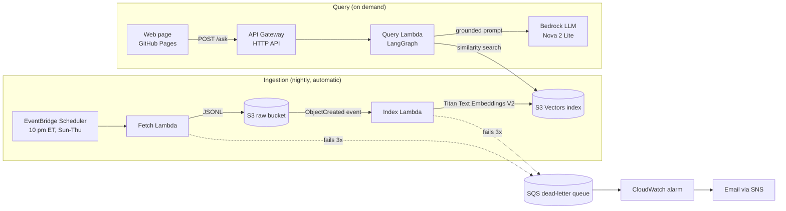
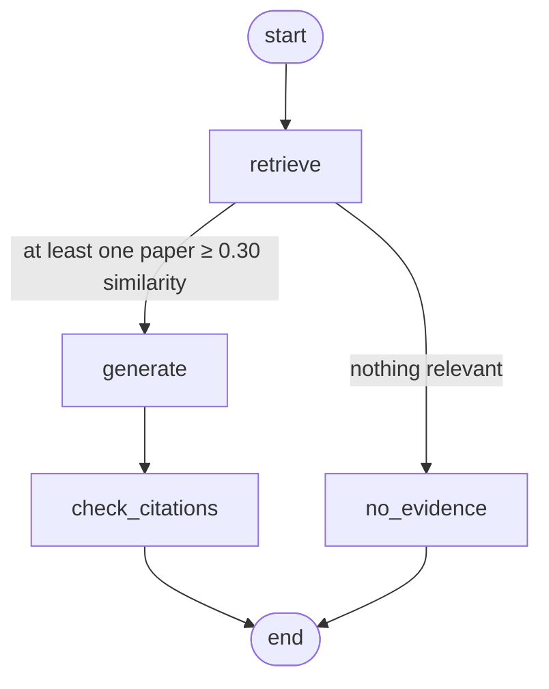

# arXiv Research Assistant

**A serverless RAG system that reads new AI papers from arXiv every night and answers questions about them with citations.**

**[Try it live](https://vaibhavarshney.github.io/arxiv-research-assistant/)**

Ask something like *"What's new in RAG evaluation?"* and get a short answer where every claim links to the paper it came from. If the index doesn't contain enough evidence, it says so instead of guessing.

    

> **Status:** Phase 1 complete (abstracts-only MVP). See the [roadmap](#roadmap) for what's next.

---

## Highlights

- **Runs itself.** A nightly schedule pulls new papers from cs.CL, cs.AI and cs.IR, and indexing starts automatically when the file lands in S3.
- **Grounded answers.** The model may only use retrieved abstracts, must cite paper IDs, and every citation is checked in code against the papers it was actually given.
- **Says "I don't know."** A similarity threshold stops weak matches from reaching the LLM. If nothing passes, the model is never called.
- **Cheap to run.** Embedding costs about **$0.006 per 1,000 papers**, and incremental indexing skips papers already in the index.
- **Fails loudly.** Failed runs retry automatically, then go to a dead-letter queue, which triggers an email alarm.
- **One command to deploy.** All of the infrastructure is defined in a single SAM template.

---

## Architecture



### The query pipeline

The query side is a small LangGraph graph. Right now it runs in a straight line. In Phase 3 it becomes an agent that can loop back and search again, which only means adding edges, not rewriting.



| Node | What it does |
|---|---|
| `retrieve` | Embeds the question, pulls the 8 nearest abstracts, keeps up to 5 above the similarity threshold |
| `generate` | Sends the kept abstracts to the LLM with strict grounding and citation rules |
| `check_citations` | Flags any cited paper ID that wasn't among the retrieved papers |
| `no_evidence` | Returns an honest "couldn't find enough" message without calling the LLM |

---

## Measured performance

All numbers below come from real runs of this system, not estimates.

| Metric | Result |
|---|---|
| Papers per day (cs.CL + cs.AI + cs.IR) | ~285 |
| Embedding cost | ~$0.006 per 1,000 papers (1,800 papers for $0.010) |
| Re-indexing 236 papers already in the index | 0 embedded, 0.6 s, $0 (incremental skip) |
| Fetch 242 papers from arXiv | 8.4 s (mostly arXiv's required 3 s pause between pages) |
| Index 242 new papers | 28.6 s |
| Query latency, warm | **~1.3 s** (retrieve ~290 ms, generate ~1.0 s) |
| Query latency, cold start | ~6.2 s (1.1 s container init + ~3.5 s importing LangGraph) |
| Tokens per query | ~1,900 in / ~100 out |
| Failure to alert email | ~2 min after the final retry |

**Laptop vs Lambda:** retrieval dropped from ~1,300 ms on a laptop to ~290 ms in a warm Lambda, because the function sits inside AWS's network next to Bedrock and S3 Vectors and reuses its open connections.

---

## Key design decisions

**S3 Vectors instead of a vector database cluster.** Storage is billed like S3, and there's no server running when nobody is searching. That fits a workload with one nightly write burst and occasional queries. The tradeoff is fewer search features than something like OpenSearch, such as no built-in keyword (BM25) search.

**One vector per abstract, no chunking.** Abstracts are short and self-contained, so splitting them would only lose context. Chunking becomes necessary in Phase 2 with full papers.

**A similarity threshold, not just top-k.** Top-k always returns k results, even when most are irrelevant. Early testing showed a sharp drop from relevant papers (~0.5) to unrelated ones (~0.2), so anything below 0.30 is dropped before the LLM sees it.

**Idempotent by design.** Every vector is keyed by its versionless arXiv ID, so re-running any step overwrites instead of duplicating. That's what makes automatic retries safe and lets the nightly job use a deliberately overlapping 4-day window.

**Incremental indexing.** Before embedding, the indexer asks S3 Vectors which IDs it already has, and only embeds new papers or newer arXiv versions. This skips about three quarters of each nightly fetch.

**Scheduled around arXiv's calendar.** arXiv announces papers around 8 pm Eastern, Sunday to Thursday, so the job runs at 10 pm on those days, in the `America/New_York` timezone so daylight saving doesn't shift it.

**Three single-purpose functions.** Fetch, index and query each get their own timeout, memory and permissions, and can be retried independently. Fetch and index are linked through an S3 event rather than calling each other directly.

**Least-privilege roles.** No function has more access than its job needs. The index function can only write to one vector index and call one embedding model.

**Model-agnostic generation.** The LLM is called through Bedrock's Converse API, and the model ID is a config value. Switching from Claude to Nova when the account couldn't access Claude was a one-line change.

**Defense at every layer of the public API:**
- API Gateway throttling: 1 request per second, bursts of 5. Excess gets a `429` before reaching Lambda.
- Input validation: question length, category allowlist, date format.
- Generic error messages to the public, with full details only in the logs.
- The web page renders all model output and paper titles as text, never HTML, which prevents XSS from injected content.
- The prompt tells the model that abstracts are data, not instructions, a basic guard against prompt injection.
- A one-command kill switch: setting Lambda concurrency to 0.

---

## What I learned

- **Top-k returns junk without a threshold.** With 300 papers indexed, one relevant paper scored 0.53 and the next four, all unrelated, scored around 0.23. All five would have gone to the LLM.
- **Prompt fixes can overcorrect.** Telling the model to admit thin evidence made it cite only 2 of 5 relevant papers. Rewording the rule restored 4 of 5. The `cited / not cited` signal on each source works as a free, built-in eval.
- **LLM output isn't deterministic.** The same question twice cited different (equally valid) papers. That matters for evaluation, so Phase 5 will pin temperature.
- **Most cold-start time was my own imports.** About 3.5 s of the 6.2 s cold start was importing LangGraph, not AWS spinning up a container.
- **CloudFormation circular dependencies are easy to create.** An S3 bucket that triggers a function, plus a function that references the bucket, is a cycle. The fix was to build the bucket name from a fixed pattern instead of referencing the resource.
- **arXiv's API follows its announcement schedule.** A "last 24 hours" query on a Sunday returns nothing, so the fetch window has to cover weekends and publication lag.

---

## Known limitations

- **Abstracts only.** Answers can only be as detailed as an abstract. Full-text indexing is Phase 2.
- **Embedding similarity is coarse.** For broad questions, many generally related papers score within a few hundredths of each other. Hybrid search and reranking are planned.
- **The smaller model sometimes overgeneralizes** from a single paper despite instructions not to.
- **No automated evaluation yet.** Quality has been checked by hand.
- **Cold starts** add a few seconds to the first question after a quiet period.
- **Coverage is limited** to three arXiv categories and to papers indexed since the project started.

---

## Project structure

```
arxiv-research-assistant/
├── app/                        # Everything that runs in Lambda
│   ├── handlers.py             # Lambda entry points: fetch, index, query
│   ├── requirements.txt        # Lambda dependencies
│   └── arxiv_rag/              # Shared package (also used by the local scripts)
│       ├── config.py           # Settings, AWS clients, structured logging
│       ├── arxiv_client.py     # arXiv API client with rate limiting and backoff
│       ├── embeddings.py       # Titan Text Embeddings V2
│       ├── indexer.py          # Incremental upserts into S3 Vectors
│       ├── retrieval.py        # Similarity search with metadata filters
│       ├── llm.py              # Grounded prompt and Bedrock Converse call
│       └── graph.py            # LangGraph pipeline
├── scripts/                    # Local CLI: fetch, index, search, ask
├── docs/index.html             # Web UI (served by GitHub Pages)
├── events/                     # Test events for invoking Lambdas by hand
├── infra/iam-dev-policy.json   # Least-privilege policy for local development
├── template.yaml               # All infrastructure (AWS SAM)
├── samconfig.toml              # Deploy settings
└── pyproject.toml              # Makes arxiv_rag installable for local use
```

---

## Run it yourself

### Prerequisites

- An AWS account with access to Amazon Bedrock in `us-east-1` (Titan Text Embeddings V2 and Nova 2 Lite)
- [AWS CLI](https://aws.amazon.com/cli/) and [AWS SAM CLI](https://docs.aws.amazon.com/serverless-application-model/latest/developerguide/install-sam-cli.html)
- Python 3.13

### Local setup

```bash
python -m venv .venv
source .venv/bin/activate          # Windows: .venv\Scripts\Activate.ps1
pip install -e .
```

Set `CONTACT_EMAIL` in `app/arxiv_rag/config.py` (arXiv asks API users to identify themselves).

```bash
python scripts/index.py --setup                     # create the vector bucket and index
python scripts/fetch.py --days 3 --max 300          # pull recent abstracts
python scripts/index.py                             # embed and store them
python scripts/ask.py "What's new in RAG evaluation?"
```

### Deploy to AWS

Edit `samconfig.toml` and set `ContactEmail` and `AlertEmail`, then:

```bash
sam build
sam deploy
```

Confirm the SNS subscription email so failure alerts reach you. Then put the `ApiUrl` from the deploy outputs into `API_URL` in `docs/index.html`, and add your site's address to the `AllowedOrigins` parameter.

### API

```bash
curl -X POST "$API_URL" \
  -H "content-type: application/json" \
  -d '{"question": "How do agents avoid bad tool calls?", "category": "cs.AI", "since": "2026-10-15"}'
```

The response includes the answer, each source with its similarity score and whether it was cited, any invalid citations, token usage and per-stage timings.

### Emergency stop

```bash
aws lambda put-function-concurrency --function-name <QueryFunctionName> --reserved-concurrent-executions 0
```

---

## Roadmap

- [x] **Phase 1:** Abstracts-only RAG with citations, nightly ingestion, public API and web UI
- [ ] **Phase 2:** Full paper text with structure-aware chunking, hybrid search (BM25 + embeddings) and reranking
- [ ] **Phase 3:** Agentic retrieval: the agent decides when to search again, compares papers, and answers multi-step questions
- [ ] **Phase 4:** Weekly email digest on followed topics
- [ ] **Phase 5:** Automated evals (citation accuracy, faithfulness, retrieval recall), model comparison, and response streaming

---

## Tech stack

**AWS:** Lambda, API Gateway (HTTP API), S3, S3 Vectors, Bedrock (Titan Text Embeddings V2, Nova 2 Lite), EventBridge Scheduler, SQS, SNS, CloudWatch, IAM, CloudFormation via SAM
**Application:** Python 3.13, LangGraph, boto3, feedparser
**Frontend:** Plain HTML, CSS and JavaScript on GitHub Pages

---

## Acknowledgments

Thank you to arXiv for use of its open access interoperability. Paper metadata is provided by arXiv under CC0. This project isn't affiliated with or endorsed by arXiv.

---

Built by **Vaibhav Varshney** · [Portfolio](https://vaibhavarshney.github.io/vaibhav-portfolio1)
